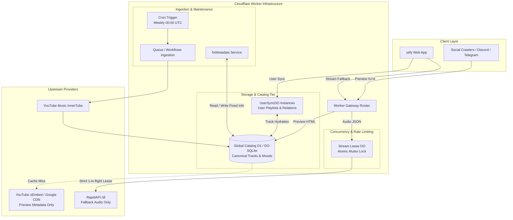

# ISSUES & ARCHITECTURAL SPECIFICATION: A NEW SPARK

## Executive Summary

This design and architectural specification addresses the issues identified in ytify:

1. **Concurrent Stream API Abuse**: Eliminates race conditions in the emergency fallback stream proxy by introducing an atomic single-writer mutex lease.
2. **Quota Starvation on RapidAPI**: Decouples social link previews and Open Graph metadata generation completely from RapidAPI, preserving 100% of the quota for real audio playback fallback.
3. **The Normalization Crisis**: Replaces disconnected, duplicated track storage across `UserSyncDO`, `fixMetadata`, and link previews with a unified, high-performance global catalog.
4. **Scraping & Dataset Consolidation**: Retires the external [`Moods-And-Genres-Dataset`](https://github.com/n-ce/Moods-And-Genres-Dataset) repository and GitHub Actions workflows by bringing the InnerTube scraping and recommendation engine natively into Cloudflare Workers with automated Cron Triggers and durable storage.

---

## 1. Problem Space Analysis & Architectural Reasoning

### 1.1 The Concurrency & Session Race Condition

- **Observed Issue**: Session-based stream API calls were added, but are still vulnerable to concurrent calls.
- **Root Cause Analysis**:
  - In `netlify/edge-functions/stream.ts`, sessions verify age and IP, while IP cooldowns are stored in Netlify Blobs.
  - Netlify Blobs operates on an **eventually consistent** model.
  - When multiple parallel requests (e.g., from an automated script or multi-threaded client) fire at the same microsecond with the same session token, all read the prior state before any write finishes.
  - As a result, all requests pass verification and trigger upstream RapidAPI calls in parallel.
- **The Solution**: An atomic **single-writer lease / mutex gatekeeper** hosted in a Cloudflare Durable Object (`StreamGateDO`).
  - Durable Objects are globally unique single-threaded actors backed by embedded SQLite.
  - Every request for a given session or IP routes to the exact same thread, guaranteeing serial execution, atomic lock checks, and zero concurrent in-flight calls.

---

### 1.2 RapidAPI Quota Waste from Link Previews & Bots

- **Observed Issue**:
  - The stream link preview currently uses the fallback API to generate Open Graph cards (`og:title`, `og:image`, `og:description`).
  - Link previews do **not** need an audio URL or adaptive stream formats; they only need metadata.
  - When fallback streams are needed during web playback, the quota has often already been burned by social bots (Twitter, Telegram, Discord, Facebook) and preview scrapers hitting `/s/:id`.
- **The Solution**:
  1. **Strict Content Gating**: RapidAPI is _physically unreachable_ for HTML requests. Under no circumstance will an HTML request trigger RapidAPI.
  2. **Tiered Zero-Cost Preview Generation**:
     - **Tier 1 (Instant Cache)**: Query the Global Normalized Catalog (`canonical_tracks`). If the track ID exists, return OG tags in <5ms with 0 external API cost.
     - **Tier 2 (Free Public Fallback)**: For catalog misses, fetch YouTube's public oEmbed API (`https://www.youtube.com/oembed?url=...`) or Google's image CDN (`https://i.ytimg.com/vi_webp/:id/mqdefault.webp`). Both are free, unauthenticated, and have no monthly limits.

---

### 1.3 The Cloudsync Normalization Crisis & Fragmented Stores

- **Observed Issue**:
  - Cloudsync stores all user tracks without identity/separation across user databases, leading to data duplication and inconsistent metadata.
  - Metadata fixing (`fixMetadata.ts`) writes clean artist names (resolving corrupted `"Release - Topic"`) to a separate SQLite DO named `global:metadata_fix_cache`.
  - Stream link previews and user libraries do not share this dataset.
- **The Solution**: Split user state into **User Relations** vs. a **Global Normalized Catalog Entity**:
  - **UserSyncDO**: Stores only relations: playlists, track ordering, timestamps, favorite flags, and custom tags.
  - **Global Catalog (Cloudflare D1 or Global DO SQLite)**: Stores deduplicated canonical track records:
    $$\text{Track}(id, title, author, authorId, duration, isSong, thumbnailId, updatedAt)$$
  - Any track resolved by `fixMetadata` or ingested via user sync immediately updates the global catalog, instantly benefiting all users, Cloudsync, and link previews.

---

### 1.4 Eliminating the External Moods & Genres Repository

- **Observed Issue**:
  - Currently, [`Moods-And-Genres-Dataset`](https://github.com/n-ce/Moods-And-Genres-Dataset) runs an external Bun script weekly via GitHub Actions to scrape YouTube Music InnerTube and generate 64 hex partitions (`normalized/<hex>.json`) and category files, hosting a recommendation endpoint on Vercel Functions.
- **The Solution**:
  - Port the InnerTube scraping logic from `Moods-And-Genres-Dataset/src/scraper.ts` directly into `src/backend/cron/` within the ytify Cloudflare Worker repository.
  - Add a weekly cron trigger (`0 0 * * 0`) in `wrangler.toml` using Cloudflare Cron Triggers and Queues/Workflows to scrape without hitting CPU/wall-clock limits.
  - Upsert scraped tracks directly into the shared Global Normalized Catalog.
  - Port the recommendation scoring logic (`score = 10 * match_count`) directly into Cloudflare Workers as `GET /api/recommend`.
  - Retire the external repository completely.

---

## 2. Target System Architecture



---

## 3. Detailed Component Designs

### 3.1 Zero-Concurrent Stream Lease Engine (`StreamGateDO`)

To guarantee that **zero concurrent calls** can ever be made by a session or IP:

1. **State Structure**:
   ```typescript
   interface StreamLeaseState {
     activeSessionId: string | null;
     inFlightUntil: number; // Timestamp when current call expires
     lastCompletedAt: number; // For enforcing post-stream cooldowns
   }
   ```
2. **Atomic Lease Protocol**:
   - When an audio request arrives (`/s/:id` with `Accept: application/json`):
     1. Forward request to `StreamGateDO` (keyed by `session_id` or `client_ip`).
     2. DO checks `Date.now() < inFlightUntil`:
        - **If True**: A request is already in flight. **Immediately reject with `429 Too Many Requests` or `409 Conflict`**. No lock queuing, no retry amplification.
        - **If False**: Grant lease, set `inFlightUntil = Date.now() + 10000` (10s max upstream timeout), and mark `activeSessionId`.
     3. Fetch RapidAPI audio stream.
     4. Release lease atomically: set `inFlightUntil = 0`, update `lastCompletedAt = Date.now()`.
3. **Key Rotation & Telemetry**:
   - Maintain RapidAPI keys, reset timestamps, and remaining request balances within the DO SQLite store, eliminating edge state desynchronization.

---

### 3.2 Decoupled Link Preview Pipeline

- **Trigger**: Any request to `/s/:id` or `/album/:id` where `Accept` is not `application/json` (or User-Agent matches social bots).
- **Pipeline Execution**:
  ```
  1. Extract Track ID: `id`
  2. Query Catalog: `SELECT title, author, is_song, thumbnail_id FROM canonical_tracks WHERE id = ?`
  3. If Found:
       Construct OpenGraph card using canonical metadata and Google webp CDN.
       Return 200 OK (0 upstream cost, <5ms response).
  4. If Not Found:
       Fetch YouTube oEmbed: `https://www.youtube.com/oembed?url=https://www.youtube.com/watch?v={id}&format=json`
       Parse oEmbed title and author.
       Async write-through to Catalog cache.
       Return 200 OK HTML.
  ```
- **Guarantee**: RapidAPI credentials and endpoints are never imported, referenced, or executed in this code path.

---

### 3.3 Unified Relational Catalog Schema (D1 / DO SQLite)

```sql
-- 1. Canonical Track Metadata Table
CREATE TABLE IF NOT EXISTS canonical_tracks (
  id TEXT PRIMARY KEY,
  title TEXT NOT NULL,
  author TEXT NOT NULL,
  author_id TEXT,
  duration INTEGER NOT NULL DEFAULT 0,
  duration_str TEXT,
  is_song BOOLEAN NOT NULL DEFAULT 0,
  thumbnail_id TEXT,
  source TEXT NOT NULL, -- 'innertube_scrape' | 'user_sync' | 'fix_metadata'
  updated_at INTEGER NOT NULL
);
CREATE INDEX IF NOT EXISTS idx_tracks_author ON canonical_tracks(author);

-- 2. Category & Section Taxonomy Table
CREATE TABLE IF NOT EXISTS categories (
  slug TEXT NOT NULL,
  type TEXT NOT NULL, -- 'mood' | 'genre'
  title TEXT NOT NULL,
  params TEXT NOT NULL,
  PRIMARY KEY (slug, type)
);

-- 3. Playlist Association Table
CREATE TABLE IF NOT EXISTS curated_playlists (
  id TEXT PRIMARY KEY,
  category_slug TEXT NOT NULL,
  category_type TEXT NOT NULL,
  section_title TEXT NOT NULL,
  title TEXT NOT NULL,
  thumbnail_id TEXT,
  track_ids TEXT NOT NULL, -- JSON array of ordered track IDs
  updated_at INTEGER NOT NULL
);

-- 4. User Normalized Relations (inside UserSyncDO)
-- In UserSyncDO, replace full track JSON with relational references:
CREATE TABLE IF NOT EXISTS user_tracks (
  track_id TEXT PRIMARY KEY,
  added_at INTEGER NOT NULL,
  play_count INTEGER DEFAULT 0,
  custom_data TEXT
);
```

---

### 3.4 In-Worker Scraper & Recommendation Engine

#### Scraper Scheduling & Execution Strategy

- YouTube Music Moods & Genres has ~49 categories and ~11,000 playlist references.
- **Architecture**:
  1. **Weekly Cron Trigger (`0 0 * * 0`)**: Fires the orchestrator.
  2. **Cloudflare Queue (`scraper-jobs`)**:
     - Orchestrator discovers category tokens from YouTube Music browse root.
     - Enqueues 1 job per category slug (`{ categorySlug, type, params }`).
  3. **Queue Consumer Worker**:
     - Consumes category jobs with controlled concurrency (`max_concurrency = 3`).
     - Extracts playlists and track items.
     - Performs bulk upserts into `canonical_tracks` and `curated_playlists` using batched SQL statements (`db.batch(...)`).

#### Recommendation Endpoint (`GET /api/recommend?ids=...`)

- Ported directly into `worker.ts`:
  1. Reads list of user track IDs (`?ids=id1,id2,...`).
  2. Runs a fast SQL search or in-memory set intersection against `curated_playlists`.
  3. Computes overlap score ($+10$ points per matching track).
  4. Returns sorted, deduplicated playlist recommendations with resolved canonical artist information.

---

## 4. Phased Implementation Plan

| Phase       | Objective                                 | Scope & Target Files                                                                                                                                  |
| :---------- | :---------------------------------------- | :---------------------------------------------------------------------------------------------------------------------------------------------------- |
| **Phase 1** | **Link Preview Decoupling**               | Modify `netlify/edge-functions/stream.ts` and `link-preview.ts` so HTML previews never touch RapidAPI. Implement oEmbed and Google CDN fallback.      |
| **Phase 2** | **Zero-Concurrent Stream Lease Engine**   | Implement single-writer concurrency mutex leasing (using DO or atomic token coordinator) for all `/s/:id` fallback stream calls.                      |
| **Phase 3** | **Global Normalized Catalog Integration** | Introduce unified `canonical_tracks` store. Refactor `fixMetadata.ts` and `UserSyncDO.ts` to read from and hydrate against the single shared catalog. |
| **Phase 4** | **Moods & Genres Scraper & API Port**     | Port scraping logic from `Moods-And-Genres-Dataset` into Cloudflare Worker scheduled triggers/queues. Add recommendation endpoint to `worker.ts`.     |
| **Phase 5** | **Retirement & Cleanup**                  | Deprecate standalone external repository; verify automated weekly cron updates and validate zero RapidAPI quota leaks.                                |

---

## 5. Verification & Testing Strategy

1. **Concurrency Stress Testing**:
   - Simulate a burst of 20 simultaneous requests using the same session token against `/s/:id`.
   - **Verification Criterion**: Exactly 1 request acquires the upstream lease; the remaining 19 are immediately rejected with `429`/`409`. Upstream RapidAPI sees exactly 1 call.
2. **Bot Preview Quota Audit**:
   - Request `/s/:id` with user agents simulating `Twitterbot/1.0`, `Discordbot/2.0`, and `facebookexternalhit/1.1`.
   - **Verification Criterion**: 200 OK Open Graph HTML is returned; zero RapidAPI network requests are initiated.
3. **Library Normalization Integrity**:
   - Perform user sync operations and verify that tracks are stored as normalized references while the client receives fully hydrated track objects with canonical metadata.
4. **Scraper Cron Verification**:
   - Execute manual trigger via `wrangler trigger cron` and verify batch ingestion into the canonical catalog without exceeding Cloudflare Worker execution limits.
