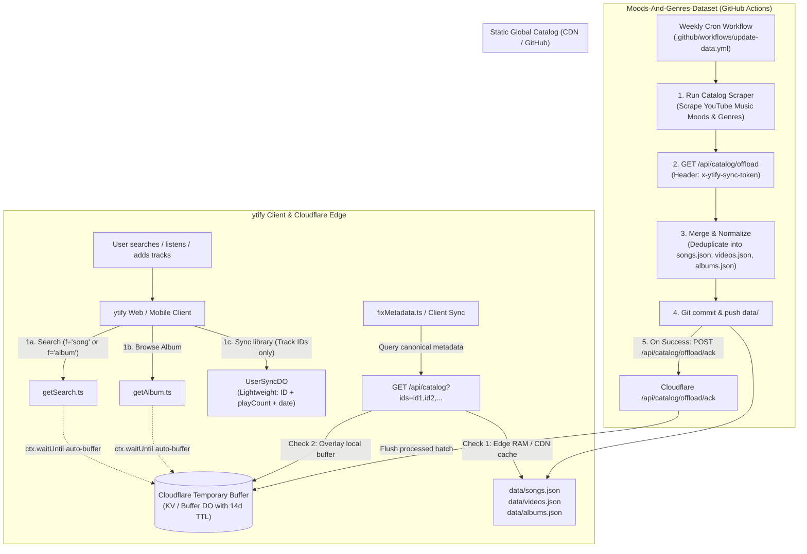

# Architecture Plan: Cloudflare Buffer to GitHub Action Track Offload Pipeline

## 1. Executive Summary & Problem Statement

### Context & Pain Points

1. **UserSyncDO Account Bloat**:
   - In ytify's multi-tenant architecture, `UserSyncDO` (Cloudflare Durable Object) stores each user's personal music library, playlists, and listening history.
   - Currently, each user's account stores complete track metadata (`title`, `author`, `authorId`, `duration`, `thumbnailId`, `albumId`) for every track in their library.
   - Popular songs are duplicated across thousands of individual user Durable Objects, consuming unnecessary SQLite row storage and compute memory.
2. **Cloudflare SQLite Limits & Cost**:
   - Maintaining a permanent, ever-growing global track catalog inside Cloudflare Durable Objects (`CatalogDO`) hit Cloudflare's daily cap of 100,000 write operations during large-scale catalog updates.
3. **The Solution**:
   - **Make user accounts ultra-lightweight**: `UserSyncDO` stores only relational user data (`trackId`, `addedAt`, `playCount`, playlist track order).
   - **Git as Permanent Catalog Master**: The `Moods-And-Genres-Dataset` repository's `data/songs.json` and `data/videos.json` act as the authoritative global track catalog.
   - **Cloudflare as a Wrapper & Temporary Buffer**:
     - Acts as a unified metadata wrapper API (`GET /api/catalog?ids=...`) for services like `fixMetadata` and user sync hydration, backed by the static Git dataset and edge caching.
     - Automatically intercepts and buffers rich metadata from internal YouTube Music operations: **search results** (filtered by `"songs"` and `"albums"`), **album browse payloads** (`getAlbum`), and user repairs.
   - **Automated Offload to GitHub Actions**: During scheduled weekly CI runs, GitHub Actions extracts the buffered tracks and albums from Cloudflare, merges them into the Git dataset, commits the changes, and instructs Cloudflare to drain the buffer.

---

## 2. System Architecture & End-to-End Data Flow



---

## 3. Cloudflare Wrapper API: `GET /api/catalog?ids=...`

Now that the master catalog lives in GitHub, Cloudflare provides a high-speed wrapper API to service backend consumers (`fixMetadata`, link previews, `UserSyncDO` client sync hydration):

### 3.1. API Specification

```http
GET /api/catalog?ids=3v2EG7ivuUM,N8NcQzMQN_U,-j7UONRegz4
```

### 3.2. Dual-Tier Resolution Strategy ($< 1\text{ms}$)

1. **Tier 1 — Edge Static Catalog Cache**:
   - Cloudflare loads or edge-caches the static `data/songs.json`, `data/videos.json`, and `data/albums.json` directly from GitHub / CDN with stale-while-revalidate caching.
   - Lookups into the static catalog map in memory are $O(1)$.
2. **Tier 2 — Pending Buffer Overlay**:
   - For any IDs not found in the static catalog, the wrapper queries the local Cloudflare temporary buffer (`pending_tracks`).
   - If a newly discovered track is in the buffer, it is returned immediately to the caller.
3. **Response**:
   ```json
   {
     "3v2EG7ivuUM": {
       "id": "3v2EG7ivuUM",
       "title": "Dreams",
       "author": "Fleetwood Mac",
       "authorId": "UClDh_rPn4n0Wz_qL5g2bX_A",
       "albumId": "MPREb_kL29aX",
       "duration": 257,
       "durationStr": "4:17",
       "thumbnailId": "AKYBqGl-DiHOSFxeVRuWo4hXVyvxc5XrsoEiChTX91s"
     }
   }
   ```

### 3.3. Primary Consumers

- **`fixMetadata.ts`**: When a user imports a playlist or external track, `fixMetadata` queries `/api/catalog?ids=...` to repair missing artists, album IDs, and thumbnails before falling back to YouTube Music searches.
- **`UserSyncDO.ts`**: During delta sync or library exports, hydrates lightweight `trackId` references for display.

---

## 4. Internal Backend Harvesting: Search & Browse Interception

Instead of relying solely on users playing or manually submitting tracks, the Cloudflare backend **passively harvests** newly discovered metadata during standard user operations:

### 4.1. "Songs" Search Filter Interception (`getSearch.ts`)

When a user searches ytify with the "songs" filter (`f === 'song'`):

- The backend queries YouTube Music: `yt.music.search(q, { type: 'song' })`.
- Every search result is an official Audio Track Video (`ATV`) containing:
  - `id` (11 characters)
  - `title`
  - `author` & `authorId`
  - `duration` & `durationStr`
  - `thumbnailId` (square album art CDN hash)
  - `album` (`id` and `name` when available)
- **Action**: In `getSearch.ts`, dispatch a non-blocking `ctx.waitUntil(bufferTracks(songs))` call to store any unseen tracks into Cloudflare's temporary buffer. Zero impact on user response latency.

### 4.2. "Albums" Search Filter Interception (`getSearch.ts`)

When a user searches ytify with the "albums" filter (`f === 'album'`):

- The backend queries YouTube Music: `yt.music.search(q, { type: 'album' })`.
- Results contain complete album release metadata:
  - `id` (`MPREb...` or `OLAK...`)
  - `title`
  - `author` & `authorId`
  - `year`
  - `thumbnailId`
- **Action**: Dispatch `ctx.waitUntil(bufferAlbums(albums))` to retain newly surfaced albums in `pending_albums`.

### 4.3. Album Browse Interception (`getAlbum.ts`)

When any user opens an album page in ytify:

- `yt.music.getAlbum(id)` retrieves the full album header **plus the complete ordered tracklist**.
- **Action**: Automatically buffers:
  1. The complete album entry with its verified `trackIds: string[]`.
  2. All child track entries with their `albumId` linkages.

---

## 5. Cloudflare Temporary Buffer & Offload Contracts

### 5.1. Buffer Storage Structure

Stored in Cloudflare KV or a lightweight Buffer Durable Object with an automatic **14-day TTL**:

- `pending_tracks:${trackId}` -> `{ id, title, author, authorId, albumId, duration, durationStr, thumbnailId, isSong }`
- `pending_albums:${albumId}` -> `{ id, title, author, authorId, year, thumbnailId, trackIds }`

### 5.2. Offload Endpoint (`GET /api/catalog/offload`)

Called by GitHub Actions runner with secret authentication header `x-ytify-sync-token`:

```http
GET /api/catalog/offload
x-ytify-sync-token: <CF_CATALOG_SYNC_TOKEN>
```

**Response (`200 OK`)**:

```json
{
  "batchId": "batch_20261027_013000",
  "counts": {
    "tracks": 4120,
    "albums": 320
  },
  "tracks": [
    {
      "id": "3v2EG7ivuUM",
      "title": "Dreams",
      "author": "Fleetwood Mac",
      "authorId": "UClDh_rPn4n0Wz_qL5g2bX_A",
      "albumId": "MPREb_kL29aX",
      "duration": 257,
      "durationStr": "4:17",
      "thumbnailId": "AKYBqGl...",
      "isSong": true
    }
  ],
  "albums": [
    {
      "id": "OLAK5uy_kL29aX",
      "title": "Rumours",
      "author": "Fleetwood Mac",
      "authorId": "UClDh_rPn4n0Wz_qL5g2bX_A",
      "thumbnailId": "sEr4Pcw8...",
      "year": "1977",
      "trackIds": ["3v2EG7ivuUM", "..."]
    }
  ]
}
```

### 5.3. Acknowledge / Drain Endpoint (`POST /api/catalog/offload/ack`)

Called by GitHub Actions **strictly after git commit and push succeed**:

```http
POST /api/catalog/offload/ack
x-ytify-sync-token: <CF_CATALOG_SYNC_TOKEN>
Content-Type: application/json

{
  "batchId": "batch_20261027_013000",
  "processedTrackIds": ["3v2EG7ivuUM", "..."],
  "processedAlbumIds": ["OLAK5uy_kL29aX", "..."]
}
```

**Response (`200 OK`)**:

```json
{
  "success": true,
  "drained": {
    "tracks": 4120,
    "albums": 320
  }
}
```

---

## 6. GitHub Actions Workflow Integration (`update-data.yml`)

The scraper repository's [`.github/workflows/update-data.yml`](file:///.github/workflows/update-data.yml) executes weekly:

```yaml
name: Periodic Data Update & Cloudflare Ingest

on:
  schedule:
    - cron: "0 0 * * 0" # Weekly on Sunday
  workflow_dispatch:

permissions:
  contents: write

jobs:
  update-dataset:
    runs-on: ubuntu-latest
    timeout-minutes: 360

    steps:
      - name: Checkout repository
        uses: actions/checkout@v7
        with:
          token: ${{ secrets.GITHUB_TOKEN }}

      - name: Set up Bun
        uses: oven-sh/setup-bun@v2
        with:
          bun-version: latest

      # Step 1: Run core YouTube Music Moods & Genres scraper
      - name: Run dataset scraper
        run: bun run src/scraper.ts

      # Step 2: Offload newly discovered tracks & albums from Cloudflare buffer
      - name: Ingest buffered tracks and albums from Cloudflare
        id: cf_ingest
        env:
          CF_WORKER_URL: ${{ secrets.CF_WORKER_URL }}
          CF_CATALOG_SYNC_TOKEN: ${{ secrets.CF_CATALOG_SYNC_TOKEN }}
        run: bun run src/ingest-buffer.ts

      # Step 3: Commit and push changes
      - name: Commit and push changes if updated
        id: git_push
        run: |
          git config user.name "github-actions[bot]"
          git config user.email "github-actions[bot]@users.noreply.github.com"
          git add data/
          if git diff --staged --quiet; then
            echo "changed=false" >> $GITHUB_OUTPUT
            echo "No changes in dataset to commit."
          else
            git commit -m "chore(data): periodically update dataset and ingest user tracks [skip ci]"
            git push
            echo "changed=true" >> $GITHUB_OUTPUT
          fi

      # Step 4: ACK & drain Cloudflare buffer only on successful push
      - name: Acknowledge and drain Cloudflare buffer
        if: steps.git_push.outputs.changed == 'true'
        env:
          CF_WORKER_URL: ${{ secrets.CF_WORKER_URL }}
          CF_CATALOG_SYNC_TOKEN: ${{ secrets.CF_CATALOG_SYNC_TOKEN }}
        run: bun run src/ingest-buffer.ts --ack
```

---

## 7. Normalization & Ingest Logic (`src/ingest-buffer.ts`)

The ingestion script enforces the repository's strict formatting and data sanitization invariants:

1. **Clean IDs**: All IDs stripped of `MPED` or `VL` prefixes via `cleanId(id)`.
2. **Author Cleanup**: Strip ` - Topic` suffix from author names.
3. **Entity Routing**:
   - `isSong === true` -> merged into `data/songs.json`.
   - `isSong === false` -> merged into `data/videos.json`.
   - Albums with `trackIds.length > 0` -> merged into `data/albums.json`.
4. **No Empty Stubs**: Albums without trackIds are strictly excluded from `data/albums.json`.
5. **Deterministic Key Sorting**: Files are saved with deterministic 2-space alphabetical key ordering via `saveDataset`.

---

## 8. Lightweight UserSyncDO Migration

In `UserSyncDO`, user library snapshots transition from heavy `TrackItem` dictionaries to lightweight reference collections:

#### Before (Heavy User DO State):

```typescript
interface LegacyUserTrack {
  id: string;
  title: string;
  author: string;
  authorId: string;
  duration: string;
  thumbnailId: string;
  albumId?: string;
  addedAt: number;
  playCount: number;
}
// Duplicated across every user who saves the track!
```

#### After (Lightweight Reference State):

```typescript
interface UserTrackReference {
  id: string; // Canonical 11-char videoId or songId
  addedAt: number; // Timestamp
  playCount?: number; // User play statistics
  favorite?: boolean; // User toggle
}

interface UserPlaylistReference {
  id: string;
  title: string;
  trackIds: string[]; // Ordered array of track IDs
  updatedAt: number;
}
```

_Result_: User DO SQLite storage drops by **~85%**, completely preventing SQLite quota exhaustion.

---

## 9. Implementation Roadmap

| Phase       | Milestone                                | Scope                                                                                                                    |
| :---------- | :--------------------------------------- | :----------------------------------------------------------------------------------------------------------------------- |
| **Phase 1** | **Cloudflare Wrapper API**               | Implement `GET /api/catalog?ids=...` in `worker.ts` with static GitHub edge caching + buffer fallback for `fixMetadata`. |
| **Phase 2** | **Passive Search & Browse Interception** | Hook `ctx.waitUntil` buffering in `getSearch.ts` (`f === 'song'` and `f === 'album'`) and `getAlbum.ts`.                 |
| **Phase 3** | **Cloudflare Offload & ACK Endpoints**   | Implement `GET /api/catalog/offload` and `POST /api/catalog/offload/ack` secured with `x-ytify-sync-token`.              |
| **Phase 4** | **Scraper Ingestion Script**             | Implement `src/ingest-buffer.ts` in `Moods-And-Genres-Dataset` to pull, normalize, and merge buffered tracks & albums.   |
| **Phase 5** | **GitHub Actions Workflow Update**       | Add ingestion and conditional ACK steps to `.github/workflows/update-data.yml`.                                          |
| **Phase 6** | **UserSyncDO Migration**                 | Refactor `UserSyncDO` to store lightweight track references and omit redundant track metadata.                           |
