# Architecture Plan: Moods & Genres (MGR) Catalog & CloudSync Sync

## 1. Executive Summary & Goals

### Context & Problems
1. **Cloudflare SQLite 100k Row Write Limit**:
   Attempting to scrape and maintain the complete Moods & Genres (MGR) catalogue inside Cloudflare Durable Object (`CatalogDO`) SQLite repeatedly exceeded Cloudflare's daily cap of 100,000 write operations.
2. **External Vercel Dependency**:
   As a temporary measure, MGR recommendations were offloaded to an external service (`ytmgr-seven.vercel.app`). This introduced runtime latency, serverless cold starts, and a third-party failure point.
3. **Missing Album Identifiers in Curated Playlists**:
   Tracks of `type: "song"` in curated playlists and the recommendation dataset frequently lacked `albumId` (`OLAK5uy_...`) and `albumTitle`, disabling the **"Go to album"** action menu item and album navigation.
4. **Cross-Format Recommendation Misses (OMV vs. ATV)**:
   Users listening on standard YouTube accumulate Official Music Video (`OMV`) IDs, whereas MGR playlists contain Audio Track Video (`ATV` / `- Topic`) IDs. Exact string matching on track IDs caused recommendations to miss legitimate overlaps.

### Goals
* **Zero Cloudflare SQLite Limit Issues**: Offload permanent catalogue storage and heavy InnerTube scraping to a weekly GitHub Actions workflow in the scraper repository (`ytmgr`).
* **Sub-Millisecond In-Memory Recommendations**: Store the normalized dataset in Git as partitioned JSON and load it into Cloudflare Worker edge memory, providing `< 0.1ms` recommendation matching and eliminating Vercel entirely.
* **Unified OMV/ATV Counterpart & Album Normalization**: Ensure all songs map to their `albumId`, square cover art, and counterpart video/audio IDs.
* **Bi-Directional Sync Flow**:
  1. Cloudflare buffers user metadata repairs and newly discovered tracks during the week.
  2. The weekly GitHub Action extracts the Cloudflare buffer via an authenticated admin API (`x-ytify-token`).
  3. The GitHub Action merges Cloudflare's buffer with the fresh MGR scrape into the Git repository.
  4. The Cloudflare buffer is pruned, keeping Cloudflare DO SQLite storage near zero.

---

## 2. Architecture & Data Flow

```mermaid
flowchart TD
    subgraph ExternalRepo ["External Scraper Repo (ytmgr / GitHub Actions)"]
        GHA["Weekly Cron: Sundays 03:00 UTC"] --> Scrape["1. Scrape YouTube Music MGR<br/>(Extract albumId, albumTitle, OMV/ATV)"]
        Scrape --> FetchCF["2. GET /api/admin/catalog-export<br/>(Header: x-ytify-token)"]
        FetchCF --> Merge["3. Merge & Deduplicate into data/*.json<br/>(albums, songs, videos, counterparts, trackIndex)"]
        Merge --> Commit["4. Git commit & push dataset to Repo"]
        Commit --> PruneCF["5. POST /api/admin/catalog-prune<br/>(Header: x-ytify-token)"]
    end

    subgraph Cloudflare ["ytify Backend (Cloudflare Edge Worker)"]
        EdgeRAM["In-Memory Catalog Cache<br/>(Hot-loaded from GitHub data/*.json)"]
        UserDO["UserSyncDO<br/>(User personal libraries only)"]
        Pending["pending_export Table<br/>(Tiny buffer in CatalogDO)"]

        Client["ytify Frontend Client"] -->|GET /api/recommend| EdgeRAM
        Client -->|POST /api/sync| UserDO
        UserDO -->|Hydrate metadata in 0.1ms| EdgeRAM
        UserDO -->|Queue unseen tracks/repairs| Pending
    end
```



---

## 3. Normalized JSON Schema Specification

The dataset is partitioned into clean, key-sorted JSON files in the scraper repository's `data/` folder:

```
repo/
├── data/
│   ├── categories.json      # Moods & Genres taxonomy chips
│   ├── playlists.json       # Curated playlist metadata & track ordering
│   ├── albums.json          # albumId -> { title, author, thumbnailId, year }
│   ├── songs.json           # songId (ATV) -> { title, author, albumId, duration, omvId }
│   ├── videos.json          # videoId (OMV) -> { title, author, duration, atvId }
│   ├── counterparts.json    # Bidirectional alias map: omvId <-> atvId
│   └── trackIndex.json      # Inverted index: trackId -> playlistIds[]
```

### TypeScript Data Contracts

```typescript
export interface CatalogDataset {
  version: number;
  updatedAt: number;

  categories: Array<{
    slug: string;
    type: "mood" | "genre";
    title: string;
    sectionTitle?: string;
  }>;

  playlists: Record<
    string,
    {
      title: string;
      categorySlug: string;
      categoryType: "mood" | "genre";
      sectionTitle: string;
      thumbnailId: string;
      trackIds: string[];
    }
  >;

  /**
   * Albums Master: Square cover art is stored HERE ONCE.
   */
  albums: Record<
    string,
    {
      title: string;
      author: string;
      authorId?: string;
      thumbnailId: string; // Square Google CDN path (/a-/... or /lh3/...)
      year?: string;
    }
  >;

  /**
   * Canonical Songs (ATVs / "- Topic" releases)
   * Inherits square cover art from albums[albumId].thumbnailId
   */
  songs: Record<
    string,
    {
      title: string;
      author: string; // Clean artist name without " - Topic"
      authorId: string;
      albumId: string; // References albums table
      duration: number; // Seconds
      durationStr: string; // "MM:SS"
      omvId?: string; // Counterpart Music Video ID
    }
  >;

  /**
   * Canonical Videos (OMVs / Video clips)
   * Video thumbnails are derived client-side: https://i.ytimg.com/vi/<id>/mqdefault.jpg
   */
  videos: Record<
    string,
    {
      title: string;
      author: string;
      authorId: string;
      duration: number;
      durationStr: string;
      atvId?: string; // Counterpart Canonical Song ID
    }
  >;

  /**
   * Bidirectional Counterpart Index:
   * Maps omvId -> atvId AND atvId -> omvId
   */
  counterparts: Record<string, string>;

  /**
   * Inverted Index for Recommendation Scoring:
   * trackId -> array of curated playlist IDs containing it
   */
  trackIndex: Record<string, string[]>;
}
```

---

## 4. `ytify` Backend Implementation Details

### 4.1 `src/backend/CatalogDO.ts`: Buffer, Export, and Prune
Add a temporary buffer table and admin routes to `CatalogDO`:

```sql
CREATE TABLE IF NOT EXISTS pending_export (
  id TEXT PRIMARY KEY,
  type TEXT NOT NULL,          -- "song" | "video"
  data TEXT NOT NULL,          -- JSON serialized metadata + album + counterpart
  updated_at INTEGER NOT NULL
);
CREATE INDEX IF NOT EXISTS idx_pending_updated ON pending_export(updated_at);
```

* **Route `GET /admin/catalog-export`**:
  * First run (migration): Selects all historical records from `canonical_songs` and `canonical_videos`.
  * Subsequent runs: Selects all records from `pending_export`.
* **Route `POST /admin/catalog-prune`**:
  * Deletes exported records: `DELETE FROM pending_export WHERE updated_at <= ?`.
* **Method `queuePendingExport(tracks)`**:
  * Invoked by `fixMetadata` and `UserSyncDO` to buffer newly discovered/repaired tracks.

### 4.2 `src/backend/worker.ts`: Token Protection
Expose the export and prune endpoints protected by `INTERNAL_TOKEN`:
```typescript
if (path === "admin/catalog-export" || path === "admin/catalog-prune") {
  if (!isInternalCaller(request, env)) {
    return unauthorized(corsHeaders);
  }
  // Forward to CatalogDO
}
```

### 4.3 `src/backend/getPlaylist.ts`: Fix Missing Album Metadata
Update the `MusicResponsiveListItem` node mapping (lines 140–155):
```typescript
const playlistId =
  song.menu?.items
    ?.find(
      (i: any) =>
        i.is?.(YTNodes.MenuNavigationItem) &&
        i.as(YTNodes.MenuNavigationItem).endpoint?.payload?.playlistId?.startsWith("OLAK"),
    )
    ?.as(YTNodes.MenuNavigationItem).endpoint?.payload?.playlistId ||
  song.album?.id ||
  "";

allItems.push({
  id: videoId,
  title: song.title?.toString() || "Unknown",
  author: itemAuthor,
  authorId: itemAuthorId,
  albumId: playlistId || undefined,
  albumTitle: song.album?.name || undefined,
  duration: formatDuration(song.duration?.text),
  subtext: song.album?.name || name || "",
  type: itemType,
});
```

### 4.4 `src/backend/catalogClient.ts`: In-Memory Matching & Vercel Retirement
* Remove `YTMGR_API_URL = "https://ytmgr-seven.vercel.app"`.
* Load the compiled `data/*.json` into Worker isolate memory (with edge caching).
* Overlap scoring algorithm:
  ```typescript
  export async function recommendPlaylists(
    env: Env | undefined,
    trackIds: string[],
    limit = 20,
  ): Promise<Recommendation[]> {
    if (trackIds.length === 0) return [];

    const dataset = await getDataset(env);
    
    // 1. Expand input IDs with OMV/ATV counterparts
    const searchIds = new Set<string>();
    for (const id of trackIds) {
      searchIds.add(id);
      const counterpart = dataset.counterparts[id];
      if (counterpart) searchIds.add(counterpart);
    }

    // 2. Score playlists using the inverted index
    const scores: Record<string, number> = {};
    for (const id of searchIds) {
      for (const plId of dataset.trackIndex[id] || []) {
        scores[plId] = (scores[plId] || 0) + 10;
      }
    }

    // 3. Return ranked playlists
    return Object.entries(scores)
      .sort(([, a], [, b]) => b - a)
      .slice(0, limit)
      .map(([id, score]) => {
        const pl = dataset.playlists[id];
        return {
          id,
          title: pl.title,
          thumbnailId: pl.thumbnailId,
          categoryType: pl.categoryType,
          categorySlug: pl.categorySlug,
          sectionTitle: pl.sectionTitle,
          score,
          trackCount: pl.trackIds.length,
          tracks: [],
          updatedAt: dataset.updatedAt,
        };
      });
  }
  ```

---

## 5. Scraper Repository Implementation (`ytmgr`)

### 5.1 Playlist Scraper Updates
When walking YouTube Music playlists via InnerTube:
1. **Extract Album**:
   * `albumTitle`: `song.album?.name`
   * `albumId`: `song.menu.items` navigation item with `OLAK5uy_...`
   * `thumbnailId`: `formatThumbnailId(song.thumbnail?.contents?.[0]?.url)`
2. **Extract Counterparts**:
   * Song → Video: `song.menu.items` navigation item with icon `MUSIC_VIDEO`
   * Video → Song: `video.menu.items` navigation item with icon `AUDIO_QUALITY`

### 5.2 Build Script (`scripts/build-dataset.ts`)
1. Scrape YouTube Music Explore → Moods & Genres categories and playlists.
2. Fetch Cloudflare buffer:
   ```bash
   GET https://ytify.pp.ua/api/admin/catalog-export
   Header: x-ytify-token: <INTERNAL_TOKEN>
   ```
3. Merge records:
   * Populate `albums`: Save unique album ID, title, and square thumbnail ID.
   * Populate `songs` and `videos`.
   * Populate `counterparts`: Link `omvId <-> atvId`.
   * Populate `trackIndex`: Build mapping from each track ID to its containing playlists.
4. Save deterministic, key-sorted JSON to `data/*.json`.
5. Call Cloudflare prune:
   ```bash
   POST https://ytify.pp.ua/api/admin/catalog-prune
   Header: x-ytify-token: <INTERNAL_TOKEN>
   ```

### 5.3 GitHub Actions Workflow (`.github/workflows/weekly-sync.yml`)
```yaml
name: Weekly Catalog & MGR Sync

on:
  schedule:
    - cron: '0 3 * * 0' # Every Sunday at 03:00 UTC
  workflow_dispatch:

jobs:
  sync:
    runs-on: ubuntu-latest
    steps:
      - uses: actions/checkout@v4
      - uses: oven-sh/setup-bun@v1
        with:
          bun-version: latest

      - name: Install Dependencies
        run: bun install

      - name: Run Scraper, Fetch CF Buffer & Build Dataset
        env:
          INTERNAL_TOKEN: ${{ secrets.INTERNAL_TOKEN }}
        run: bun run scripts/build-dataset.ts

      - name: Commit & Push Updated Dataset
        run: |
          git config user.name "github-actions[bot]"
          git config user.email "github-actions[bot]@users.noreply.github.com"
          git add data/
          git commit -m "chore(data): weekly catalog & moods sync [skip ci]" || echo "No changes to commit"
          git push
```

---

## 6. Security & Secret Configuration

1. **Generate Secret**:
   Generate a 32-character random string (e.g. `ytify_sec_...`).
2. **Configure in Cloudflare**:
   ```bash
   npx wrangler secret put INTERNAL_TOKEN
   ```
3. **Configure in GitHub Scraper Repository**:
   Add Repository Secret under **Settings → Secrets and variables → Actions**:
   * Name: `INTERNAL_TOKEN`
   * Value: `<your generated secret>`

---

## 7. Migration & Rollout Checklist

- [ ] **Step 1**: Implement `pending_export`, `admin/catalog-export`, and `admin/catalog-prune` in `ytify`.
- [ ] **Step 2**: Configure `INTERNAL_TOKEN` in Cloudflare and GitHub Secrets.
- [ ] **Step 3**: Deploy updated `ytify` Worker.
- [ ] **Step 4**: Run initial GitHub Action workflow manually. Drain all existing historical records from `CatalogDO` into `data/*.json` in the Git repository.
- [ ] **Step 5**: Update `catalogClient.ts` to consume the dataset in memory, retiring `ytmgr-seven.vercel.app`.
- [ ] **Step 6**: Fix `getPlaylist.ts` to attach `albumId` and `albumTitle`.
- [ ] **Step 7**: Verify tests with `bun test scripts/catalog.test.ts`.
