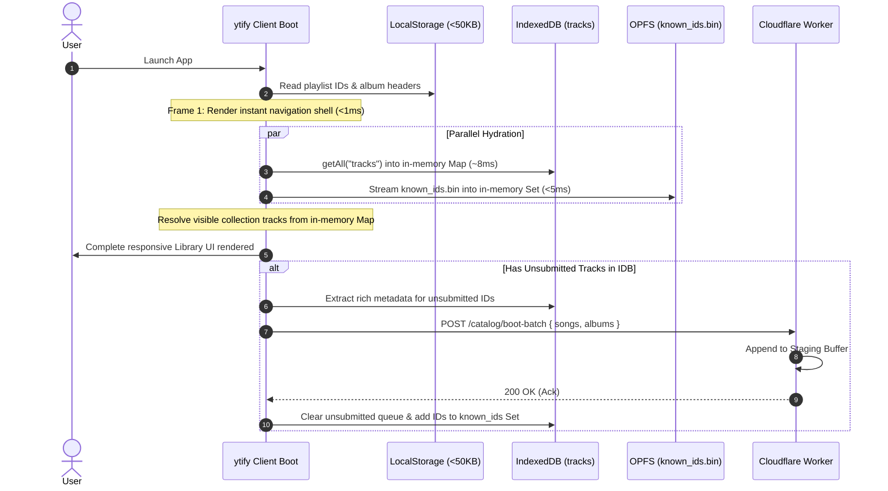

# Architecture Plan: Local-First Catalog (OPFS + IndexedDB) & Decoupled CloudSync

> **Status: Active Draft (RFC - Revised).**  
> **Supersedes:**
>
> - [`plan-cloudflare-gh-action-track-offload.md`](file:///C:/Users/Animesh/Documents/ytify/docs/plan-cloudflare-gh-action-track-offload.md)
> - [`plan-mgr-catalog-sync-architecture.md`](file:///C:/Users/Animesh/Documents/ytify/docs/plan-mgr-catalog-sync-architecture.md)
> - [`plan-normalized-catalog-architecture.md`](file:///C:/Users/Animesh/Documents/ytify/docs/plan-normalized-catalog-architecture.md)
> - [`plan-omv-atv-counterpart-mapping.md`](file:///C:/Users/Animesh/Documents/ytify/docs/plan-omv-atv-counterpart-mapping.md)

---

## 1. Homage & Lineage: Respects to Prior Plans

Before charting the new path, we must pay tribute to the lineage of architectural plans that brought ytify to this point. Each earlier plan made vital conceptual breakthroughs, but each stumbled against the hard physics of **Cloudflare Durable Object write limits (100,000 writes/day)** because they all forced the backend server to do live writes during active user traffic.

### The Ancestry of Catalog Plans

| Plan                                                | Core Breakthrough                                                                                                                                                                             | Where It Stumbled                                                                                                                                            | Final Fate                                                                                                             |
| :-------------------------------------------------- | :-------------------------------------------------------------------------------------------------------------------------------------------------------------------------------------------- | :----------------------------------------------------------------------------------------------------------------------------------------------------------- | :--------------------------------------------------------------------------------------------------------------------- |
| **1. `plan-mgr-catalog-sync-architecture.md`**      | Identified the value of the static [Moods & Genres Dataset](https://github.com/n-ce/Moods-And-Genres-Dataset) for $O(1)$ edge recommendations and curated playlists.                          | Relied on an external Vercel scraper (`ytmgr`) and live bi-directional sync through a Cloudflare DO buffer.                                                  | **Retired.** Vercel cold starts and brittle synchronization forced retirement in commit `71623b5`.                     |
| **2. `plan-normalized-catalog-architecture.md`**    | Discovered the strict separation between official **Songs** (`MUSIC_VIDEO_TYPE_ATV`, "- Topic", square art, album IDs) and generic **Videos** (`MUSIC_VIDEO_TYPE_OMV`, 16:9 thumbnails, UGC). | Attempted to store and write all catalog tracks inside a centralized `CatalogDO` SQLite database during active user sessions.                                | **Retired.** In commit `48a6b66`, `CatalogDO` had to be deleted after repeatedly exceeding the 100k daily write quota. |
| **3. `plan-omv-atv-counterpart-mapping.md`**        | Engineered the pairing of Official Music Videos with Audio Track Videos so users could seamlessly switch between audio and video formats without losing metadata.                             | Coupled counterpart mapping directly into `CatalogDO` row updates.                                                                                           | **Shelved.** Left without a backend storage engine once `CatalogDO` was removed.                                       |
| **4. `plan-cloudflare-gh-action-track-offload.md`** | First recognized that `UserSyncDO` was bloated with duplicate track metadata and proposed Git as the permanent catalog master via periodic offloading.                                        | Still relied on the Cloudflare Worker to intercept and buffer searches, album loads, and user repairs in real-time (`ctx.waitUntil auto-buffer` into KV/DO). | **Superseded.** Server-side interception still caused high execution and storage thrashing.                            |

### The Root Insight: Catalog Data $\neq$ User Library Data

The crucial architectural breakthrough is recognizing the strict separation between two completely different domains:

1. **Global Discovery Catalog (from `Moods-And-Genres-Dataset`)**:
   - Master curated playlists, categories, and album discovery metadata (`< 5 MB` total).
   - Stored in **OPFS** so the user has instant, offline, zero-network discovery and shelf navigation.
   - We **never** attempt to store the millions of global individual songs or videos in the client. The global song catalog stays sharded on GitHub / CDN and is accessed on-demand.
2. **User Library Data**:
   - Personal playlists, favorites, history, and subscriptions.
   - Collections are lightweight ID arrays (`string[]`) and headers (`ListItem[]`) kept in **LocalStorage (< 50 KB)** for instant synchronous Frame-1 UI rendering.
   - User-resolved track entities (`TrackItem`, including both songs and videos) are persisted in **IndexedDB** and cached in an in-memory `Map`, eliminating the 5 MB LocalStorage quota and avoiding $O(N)$ write amplification.

---

## 2. Storage Architecture: The Four Tiers of State

State is strictly partitioned across four tiers, using the exact storage medium best suited for each data type:

```
┌────────────────────────────────────────────────────────────────────────┐
│                        TIER 1: USER LOCALSTORAGE                       │
│  • Collection ID lists (library_favorites, library_history, etc.)      │
│  • Lightweight saved headers (library_albums, playlists, channels)     │
│  • UI preferences & configuration (config, drawer, volume)             │
│  • Collection timestamps & sync meta (library_meta)                    │
│  • ZERO heavy track metadata objects (< 50 KB total, Frame-1 sync paint)│
└────────────────────────────────────────────────────────────────────────┘
                                     │
                                     ▼
┌────────────────────────────────────────────────────────────────────────┐
│                 TIER 2: CLIENT PERSISTENCE (IDB + OPFS)                │
│                                                                        │
│  IndexedDB (idb_catalog):                                              │
│  • tracks store (User-resolved TrackItems: songs & videos)             │
│  • unsubmitted_ids store (New tracks pending boot upload)              │
│  • In-memory Map<string, TrackItem> cache for O(1) runtime lookups   │
│                                                                        │
│  OPFS (navigator.storage):                                             │
│  • catalog/albums.json (Master album discovery metadata, ~2-3 MB)      │
│  • catalog/playlists.json & categories.json (Curated discovery taxonomy)│
│  • catalog/known_ids.bin (11-byte fixed-width binary deduplication key)│
│  • opus_cache/*.opus (Offline audio streams)                           │
│  • opus_cache/*.thumb (Cached album artwork & thumbnails)               │
└────────────────────────────────────────────────────────────────────────┘
                                     │
                          (Sync & Boot Batch Only)
                                     ▼
┌────────────────────────────────────────────────────────────────────────┐
│                       TIER 3: CLOUDFLARE BACKEND                       │
│  • UserSyncDO (Pure relational: user_tracks IDs, playlist ordering)    │
│  • Staging buffer for POST /catalog/boot-batch submissions             │
│  • ZERO heavy track metadata JSON blobs stored in UserSyncDO           │
└────────────────────────────────────────────────────────────────────────┘
                                     │
                          (Weekly Offload Batch)
                                     ▼
┌────────────────────────────────────────────────────────────────────────┐
│                      TIER 4: GITHUB REPOSITORY                         │
│  • Authoritative Master Catalog (Moods-And-Genres-Dataset)             │
│  • First-letter sharded tracks: data/songs/{first_char}.json           │
│  • Master albums, curated playlists, and taxonomy (data/albums.json)   │
│  • Global compact key index: data/knownIds.bin (~120 KB Brotli)        │
└────────────────────────────────────────────────────────────────────────┘
```

### Detailed Breakdown of Each Tier

| Tier                            | Storage Medium                                           | Exact Keys / Files                                                                                                                                                                                                                      | Contents & Purpose                                                                                                                                                                                                                                                                                                                                                                | Size Budget / Quota                                                                                                                 |
| :------------------------------ | :------------------------------------------------------- | :-------------------------------------------------------------------------------------------------------------------------------------------------------------------------------------------------------------------------------------- | :-------------------------------------------------------------------------------------------------------------------------------------------------------------------------------------------------------------------------------------------------------------------------------------------------------------------------------------------------------------------------------- | :---------------------------------------------------------------------------------------------------------------------------------- |
| **Tier 1: Client LocalStorage** | Browser `localStorage`                                   | `library_favorites`<br>`library_history`<br>`library_liked`<br>`library_listenLater`<br>`library_<custom>`<br>`library_albums`<br>`library_playlists`<br>`library_channels`<br>`library_cached`<br>`library_meta`<br>`config`, `drawer` | **User references & UI ordering only.**<br>Collections store arrays of 11-char strings (`["id1", "id2", ...]`).<br>Albums/playlists/channels store lightweight `ListItem` headers (`id`, `name`, `author`, `img`).<br>`library_cached` holds device-local LRU order.<br>`library_meta` holds version timestamps.<br>**`library_tracks` is removed from LocalStorage completely.** | **< 50 KB total.**<br>Permanently immune to the browser's 5 MB `localStorage` quota limit.<br>Instant synchronous Frame-1 UI paint. |
| **Tier 2A: Client IndexedDB**   | Browser IndexedDB (`idb_catalog`)                        | `tracks` object store<br>`unsubmitted_ids` store                                                                                                                                                                                        | **User-resolved track metadata.**<br>Stores normalized `TrackItem` records (both songs and videos) the user has played, liked, or browsed.<br>Hydrated into an in-memory `Map<string, TrackItem>` on boot.<br>Single-record $O(1)$ writes (`idb.put`) without write amplification.<br>`unsubmitted_ids`: queue of unknown IDs pending next boot batch.                            | **Tens of Megabytes** allowed by browser IDB quotas.<br>Native structured cloning (zero `JSON.stringify` / `JSON.parse` overhead).  |
| **Tier 2B: Client OPFS**        | Browser Origin Private File System (`navigator.storage`) | `catalog/albums.json`<br>`catalog/playlists.json`<br>`catalog/categories.json`<br>`catalog/known_ids.bin`<br>`opus_cache/*.opus`<br>`opus_cache/*.thumb`                                                                                | **Global discovery catalog & binary media.**<br>`catalog/*.json`: Master curated playlists and album discovery dataset from `Moods-And-Genres-Dataset` ($< 5\text{ MB}$ total) for instant offline browse.<br>`known_ids.bin`: raw 11-byte ASCII ID buffer for $O(1)$ duplicate checks.<br>`opus_cache/`: cached audio streams & cover art.                                       | **Multiple Gigabytes** allowed by browser OPFS quotas.<br>Fast, non-blocking asynchronous streaming file I/O.                       |
| **Tier 3: Cloudflare Backend**  | Cloudflare Workers & Durable Objects (`UserSyncDO`)      | `UserSyncDO.sqlite`:<br>`- user_tracks`<br>`- collections`<br>`- deleted_tracks`<br>`- meta`<br><br>Staging Buffer:<br>`- R2 / KV / DO Batch`                                                                                           | **Lightweight relational user sync.**<br>`user_tracks`: `(track_id, added_at, play_count)`.<br>`collections`: `(name, track_ids TEXT, modified)`.<br>**Stores NO track metadata JSON blobs.**<br>Staging buffer gathers boot-submitted tracks to export to GitHub.                                                                                                                | **Near Zero DO storage overhead.**<br>Sync payloads reduced by >90%. Immune to 100K write limits.                                   |
| **Tier 4: GitHub Repository**   | Git & GitHub Pages / CDN (`Moods-And-Genres-Dataset`)    | `data/songs/{char}.json`<br>`data/albums.json`<br>`data/playlists.json`<br>`data/categories.json`<br>`data/knownIds.bin`                                                                                                                | **Authoritative, permanent global catalog.**<br>`data/songs/` is sharded by the first character of the ID (~64 shards of ~200-500 KB each).<br>`knownIds.bin`: compressed binary keys file.<br>GitHub Actions scraper cleans and merges user staging tracks weekly.                                                                                                               | **Unlimited Git / CDN storage.**<br>Static file delivery via GitHub raw / jsDelivr / Cloudflare Edge Cache.                         |

---

## 3. Why the Current Local Library Already Fits This Model

An inspection of [`src/modules/library.ts`](file:///C:/Users/Animesh/Documents/ytify/src/modules/library.ts) and [`src/types.d.ts`](file:///C:/Users/Animesh/Documents/ytify/src/types.d.ts) reveals that the existing library architecture is **already fundamentally relational**:

1. **Collections are already pure ID arrays**:
   `library_favorites`, `library_history`, `library_liked`, etc., do not store track objects—they already store arrays of strings: `["id1", "id2", "id3"]`.
2. **Library Albums & Playlists are already lightweight headers**:
   [`Album`](file:///C:/Users/Animesh/Documents/ytify/src/types.d.ts#L89) is defined as `ListItem & { author: string }`. It only contains `{ id, name, author, img }`. 10 to 50 saved albums take only ~3 KB to 10 KB of JSON. Keeping them in `localStorage` allows instant synchronous rendering of the Library view.
3. **Videos and Songs are already unified**:
   Both Official Music Videos (OMV) and Audio Track Videos (ATV) share the 11-character YouTube video ID and conform to `TrackItem`. They reside in the same track store without needing separate stores.
4. **The Only Existing Flaw**:
   The track dictionary (`library_tracks`) was stored in `localStorage`. For users with 1,000+ tracks, `library_tracks` swelled to megabytes, causing `QuotaExceededError` crashes and multi-millisecond synchronous JSON parsing freezes on the main thread.

### The Migration: Moving `library_tracks` to IndexedDB + In-Memory Map

- Collections and lightweight album/playlist headers remain in `localStorage` as fast, synchronous JSON arrays.
- `library_tracks` is removed from `localStorage` and placed into **IndexedDB (`idb_catalog / tracks`)**.
- On startup, `tracks` is loaded once into an in-memory `Map<string, TrackItem>`.
- [`toCollectionItems()`](file:///C:/Users/Animesh/Documents/ytify/src/modules/library.ts#L155) reads rich metadata from the in-memory `Map` with **zero latency (< 0.01 ms)** and zero stringification.
- When tracks are played or favorited, only that single record is written to IndexedDB (`await idb.put("tracks", track)`).
- If a track is missing from local storage (e.g. fresh device login), it is resolved from the first-letter GitHub shard.

---

## 4. End-to-End System Data Flow

```mermaid
flowchart TD
    subgraph Browser ["User Browser Environment"]
        subgraph LocalStorage ["Tier 1: LocalStorage (<50KB, Frame-1 Paint)"]
            Collections["library_favorites, library_history, etc.\n(Arrays of Track IDs only: string[])"]
            Headers["library_albums, library_playlists, library_channels\n(Lightweight ListItem headers)"]
            Prefs["config, drawer, library_meta"]
        end

        subgraph InMem ["Runtime Memory"]
            TrackCache["In-Memory Map<string, TrackItem>\n(Instant <0.01ms UI dereferences)"]
        end

        subgraph IDB ["Tier 2A: IndexedDB (idb_catalog)"]
            IDBTracks[("tracks store\n(User-resolved TrackItems: songs & videos)")]
            PendingQueue[("unsubmitted_ids store\n(New IDs pending boot upload)")]
        end

        subgraph OPFS ["Tier 2B: OPFS (navigator.storage)"]
            KeyIndex["known_ids.bin\n(~500 KB Fixed 11-byte Binary Index)"]
            DiscoveryCatalog["catalog/albums.json & playlists.json\n(Master Discovery Dataset, <5MB)"]
            AudioCache["opus_cache/\n(.opus audio & .thumb artwork)"]
        end

        UI["Search, Album, Artist & Library UI"]
        Player["Audio Player"]
        BootHook["App Startup Boot Hook"]
        LoginHook["One-Time CloudSync Login Hook"]
    end

    subgraph Cloudflare ["Tier 3: Cloudflare Backend"]
        UserDO["UserSyncDO\n(Pure Relational: track_id, added_at, collections)"]
        BootAPI["POST /catalog/boot-batch"]
        StagingQueue[("Temporary Ingestion Buffer")]
    end

    subgraph GitHubMaster ["Tier 4: GitHub Master (Moods-And-Genres-Dataset)"]
        Shards["data/songs/{first_char}.json\n(~64 shards: A.json, 9.json, etc.)"]
        GHActions["Scheduled Weekly GitHub Action Pipeline"]
        MasterGit["Master Git Dataset (data/)"]
    end

    %% Normal User Interactions (Zero server writes)
    UI -->|"1. Instant render from memory & LocalStorage"| TrackCache
    Collections -.->|"2. Resolve track IDs"| TrackCache
    UI -->|"3. Browse curated playlists / albums"| DiscoveryCatalog
    Player -->|"4. Play audio (Device-local cache)"| AudioCache
    UI -->|"5. Add to playlist / favorite (IDs only)"| Collections
    UI -->|"6. Save resolved track (O(1) write)"| IDBTracks
    IDBTracks -.->|"Hydrate on boot"| TrackCache

    %% Boot Process & Deduplication
    BootHook -->|"7a. Scan new tracks in pending queue"| PendingQueue
    PendingQueue -.->|"7b. Filter against known keys"| KeyIndex
    BootHook -->|"7c. POST single batch (Unknown tracks only)"| BootAPI
    BootAPI -->|"8. Append to staging"| StagingQueue

    %% CloudSync Login & Shard Hydration
    LoginHook -->|"9. Pull user playlists (Track IDs only)"| UserDO
    UserDO -->> LoginHook: Return 1,000 track IDs
    LoginHook -->|"10. Group IDs by first character"| Shards
    Shards -->>|"11. Fetch matching shards (~300KB each)"| IDBTracks
    IDBTracks -.->|"12. Populate memory cache"| TrackCache
    TrackCache -->|"13. Render complete Library UI"| UI

    %% Offload to GitHub
    StagingQueue -.->|"14. Extract buffered submissions"| GHActions
    GHActions -->|"15. Validate, deduplicate & update shards"| MasterGit
    MasterGit -.->|"16. Update static knownIds.bin"| KeyIndex
```

---

## 5. One-Time CloudSync Login: First-Letter Sharding Protocol

When a user logs into a fresh device with 1,000 tracks in CloudSync:

1. **Pure ID Transfer from Cloudflare**:
   The client receives an array of 1,000 track IDs from `UserSyncDO`. Because no track metadata JSON is transferred, the CloudSync pull takes **< 50 milliseconds** (~15 KB payload).
2. **Client-Side Grouping by First Character**:
   The client groups the 1,000 IDs by their starting character:
   ```ts
   const shardsNeeded = new Set(trackIds.map((id) => id[0]));
   ```
   A 1,000-song library spans approximately 25 to 35 unique characters.
3. **Direct Shard Fetching from GitHub / CDN**:
   The client downloads only the matching shards from GitHub (`https://raw.githubusercontent.com/n-ce/Moods-And-Genres-Dataset/main/data/songs/${char}.json`).
   - Each shard is only **~200 KB to ~500 KB uncompressed** (and compresses to **~40–60 KB with Brotli**).
   - Zero Cloudflare Worker compute or memory consumed.
   - Zero database queries.
4. **Appended into IndexedDB & In-Memory Map**:
   The client extracts the matching songs from each shard and writes them into IndexedDB `tracks` using a single bulk transaction, simultaneously populating the in-memory `Map`.
5. **Cached Permanently**:
   Once resolved into IndexedDB, these 1,000 tracks live on the device permanently. Subsequent launches and offline playback read from memory/IndexedDB with **0 network requests**.

---

## 6. Strict Invariant: No YouTube `getInfo` Calls

> [!CAUTION]
> **Mandated by [`AGENTS.md`](file:///C:/Users/Animesh/Documents/ytify/AGENTS.md#L43)**:
> The backend and client MUST NEVER call `yt.getInfo`, `yt.music.getInfo`, or video player endpoints to resolve or scrape track metadata. YouTube heavily restricts and rate-limits these endpoints (causing 429s, SABR blocks, and bot-detection challenges).
>
> All track metadata MUST resolve exclusively from:
>
> 1. The local client in-memory cache and IndexedDB.
> 2. The first-letter master shards in `Moods-And-Genres-Dataset`.
> 3. Organic user browse payloads (albums, artist discographies, search results).

---

## 7. Client Boot Lifecycle & Deduplication Protocol



---

## 8. Implementation Milestones

### Phase 1: Track Store Engine (`src/modules/trackStore.ts`)

- Implement an in-memory `Map<string, TrackItem>` cache backed by IndexedDB (`idb_catalog`).
- Migrate `library_tracks` out of `localStorage` into IndexedDB:
  - Synchronous lookups use `trackCache.get(id)`.
  - Mutations call `await trackStore.put(track)` without full-dictionary rewrites.
- Preserve `library_albums`, `library_playlists`, and `library_channels` in `localStorage` as lightweight JSON headers.

### Phase 2: Key-Only Baseline Index (`known_ids.bin` in OPFS)

- Generate `known_ids.bin` from `Moods-And-Genres-Dataset` (~120 KB Brotli-compressed, contiguous 11-byte ASCII chunks).
- Implement fast binary streaming from OPFS into an in-memory `Set<string>`.
- Filter incoming entities: only enqueue to `unsubmitted_ids` if `!knownIds.has(id)`.

### Phase 3: Global Discovery Catalog in OPFS

- Cache `catalog/albums.json` and `catalog/playlists.json` from `Moods-And-Genres-Dataset` ($< 5\text{ MB}$ total) directly into OPFS for instant offline browse and category shelves.
- Ensure full song/video catalogs are **not** bundled into monolithic OPFS files.

### Phase 4: First-Letter Sharding in Dataset Repo

- Update the `Moods-And-Genres-Dataset` scraper pipeline to partition `data/songs/` into first-character shards (`[A-Za-z0-9_-].json`).
- Generate and publish `data/knownIds.bin`.

### Phase 5: Decouple `UserSyncDO` to Pure Relational State

- Migrate `UserSyncDO.ts` to drop `tracks.data` JSON blobs in favor of relational `user_tracks` and ID arrays in `collections`.
- Update `src/modules/cloudSync.ts` to sync IDs only.
- Implement client-side login resolver: group IDs by `id[0]`, fetch matching shards from GitHub/CDN, and write directly into IndexedDB (`tracks`).

---

## 9. Conclusion

This revised architecture cleanly balances performance, storage limits, and network efficiency:

- **User LocalStorage (< 50 KB)**: Holds lightweight user preferences, playlist ID arrays, and album/channel headers for instant Frame-1 synchronous UI rendering.
- **Client IndexedDB**: Persists the user's normalized tracks with $O(1)$ writes, zero JSON stringification overhead, and an in-memory cache for zero-latency UI resolution.
- **Client OPFS**: Holds global discovery catalog metadata (`albums.json`, `playlists.json`), offline media (`.opus`, `.thumb`), and the 11-byte binary deduplication index (`known_ids.bin`).
- **Cloudflare Backend**: Manages lightweight relational sync for user IDs with zero heavy metadata writes.
- **GitHub Repository**: Serves as the authoritative, sharded master catalog distributed globally via CDN with Brotli compression.
