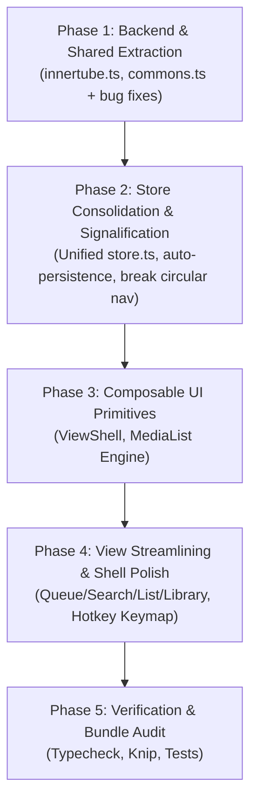

# Unified Architecture Refactoring Plan

**Target System:** `ytify` (SolidJS SPA + Cloudflare Worker Edge Backend)  
**Status:** Architecture Blueprint & Implementation Roadmap  
**Scope:** Core Directory Layout, Backend/Shared Separation, Store Consolidation & Signalification, Composable UI Primitives, Codebase Bug Fixes

---

## 1. Executive Summary & Core Architectural Decisions

This document consolidates our architectural decisions regarding structural reorganization, store unification, state scoping, UI component consolidation, and targeted code fixes.

### Key Architectural Tenets

1. **Strict Runtime Boundary Enforcement (Edge vs. Browser vs. Isomorphic)**
   - Backend code (`worker.ts`, `innertube.ts`, `UserSyncDO.ts`) targets Cloudflare Workers / Node runtime and imports `@cloudflare/workers-types` and `youtubei.js`. It must **never** leak into or be co-located with browser client modules in a generic "junk drawer" `core` folder.
   - Frontend code (`index.tsx`, `store.ts`, `features/`, `components/`) targets the browser DOM and SolidJS.
   - Isomorphic code (`commons.ts`, shared types) lives in `src/shared/`, containing only pure functions safe for both runtimes.
2. **Entrypoints Stay at the Root / Shell**
   - `src/index.tsx` is the browser entry point referenced by `index.html`. It serves as the outer orchestrator and application shell.
   - `src/backend/worker.ts` is the backend entry point referenced by `wrangler.toml`. Note: `localAdapter.ts` already adapts `worker.fetch()` directly for Vite dev, so routing remains single-sourced.
   - Entrypoints consume dependencies; they are not core building blocks.
3. **Break Circular UI Dependencies in State**
   - Currently, `src/store.ts` lazy-imports feature components (`Search`, `Queue`, `List`, `Library`) into `navStore`, while those features import `@stores`.
   - **Fix:** Remove lazy components from `navStore`. `navStore` purely stores navigation state (`active` tab, panel refs). The component dictionary lives in `src/index.tsx` as a plain object (`const views = { search: lazy(...), ... }`), completely breaking the circular loop.
4. **State Topology: Global Store vs. Local Signals**
   - **Unified Store:** Persistent application-wide domain data (`player`, `queue`, `nav`, `config`, `drawer`, `locale`, `syncState`) consolidated into namespaced slices under a single `store`/`setStore`.
   - **Automatic Persistence:** Replace manual `lsSetJSON` calls with reactive root effects (`createEffect(() => lsSetJSON("config", store.config))`) that track all proxy reads.
   - **Signalification:** Ephemeral/transient UI state (`isOpen`, `isHovered`, `activeLyricsLine`, `searchQueryDraft`, list `markList`, filter pills) should remain or be converted into local `createSignal` instances tied to component lifecycles to prevent stale state bugs and memory leaks.
5. **UI Composition over Monolithic Polymorphism**
   - Avoid creating a single "Mega-Component" (`<DynamicView type="queue|search|list|library" />`) with nested `Switch/Match` blocks.
   - Instead, extract the **shared UI grammar** into reusable primitives:
     - `<ViewShell>`: Standardizes sticky headers, `<HeaderNav>`, action slots, and scroll anchoring.
     - `<MediaList>`: Unifies the duplicated list/sortable rendering engine across `Queue`, `Search`, and `List`.
     - `<Shelf>`: Standardizes horizontal carousels.

---

## 2. Target Directory Structure

```text
ytify/
├── docs/
│   ├── chat-with-claude.md
│   ├── plan-modularization.md
│   └── plan-unified-architecture-refactoring.md
├── src/
│   ├── backend/                     # Server / Cloudflare Worker Runtime
│   │   ├── worker.ts                # Worker entrypoint (wrangler.toml: main)
│   │   ├── innertube.ts             # Extracted: Innertube client factory & MemoryCache
│   │   ├── utils.ts                 # Backend-specific transforms & node parsing
│   │   ├── localAdapter.ts          # Connect middleware bridge to worker.fetch()
│   │   ├── UserSyncDO.ts            # Cloudflare Durable Object for cloud sync
│   │   └── endpoints/ (or handlers) # Individual get*.ts route handlers
│   │
│   ├── shared/                      # Isomorphic: 100% safe for BOTH browser & worker
│   │   ├── commons.ts               # Shared pure helpers (duration, string sanitize, regex, formatting)
│   │   └── types.ts                 # Shared API payloads, Song/Track/Playlist interfaces
│   │
│   ├── components/                  # Reusable UI Primitives
│   │   ├── ViewShell.tsx            # Standardized layout, sticky bar, HeaderNav, scroll ref
│   │   ├── MediaList.tsx            # Unified list engine (sortable, track rows, channel items)
│   │   ├── Shelf.tsx                # Unified horizontal carousel container
│   │   ├── HeaderNav.tsx
│   │   ├── HeaderActions.tsx
│   │   ├── StreamItem.tsx
│   │   ├── ListItem.tsx
│   │   ├── MiniPlayer.tsx
│   │   └── NavBar.tsx
│   │
│   ├── features/                    # Thin View Orchestrators (20-60 lines each)
│   │   ├── Queue/                   # Uses <ViewShell> + <MediaList draggable removeMode>
│   │   ├── Search/                  # Uses <ViewShell> + <MediaList shelf emptyFallback>
│   │   ├── List/                    # Uses <ViewShell> + <MediaList shelf markMode>
│   │   ├── Library/                 # Uses <ViewShell> + <Collections> + <Shelf>
│   │   ├── Player/                  # Expanded audio/video player modal & controls
│   │   └── Settings/                # Application preferences & toggles
│   │
│   ├── modules/                     # Frontend Feature Services & I/O
│   │   ├── playback.ts              # Audio element orchestrator
│   │   ├── audioCache.ts            # OPFS cache
│   │   ├── library.ts               # LocalStorage & collection management
│   │   ├── theme.ts                 # CSS variables & dynamic themes
│   │   └── sponsorBlock.ts
│   │
│   ├── store.ts                     # Single consolidated store (config, nav, player, queue, etc.)
│   ├── types.d.ts                   # Ambient global frontend types
│   ├── vite-env.d.ts                # Vite client reference types
│   └── index.tsx                    # Frontend bootstrap, keyboard router, & root <App /> shell
```

---

## 3. State Scoping Matrix: Store vs. Signal

| State Domain                                      | Location                     | Justification                                                                                                   |
| :------------------------------------------------ | :--------------------------- | :-------------------------------------------------------------------------------------------------------------- |
| `config` (language, quality, themes, flags)       | `store.config`               | Read globally across playback, UI, and settings. Automatically persisted to `localStorage` via reactive effect. |
| `drawer` (last played list, drawer open states)   | `store.drawer`               | Persisted navigation state. Automatically persisted via effect.                                                 |
| `player` (current track, playbackState, progress) | `store.player`               | Shared by Player view, MiniPlayer, MediaSession, and Audio handlers.                                            |
| `queue` (`list`, `history`, `isLoading`)          | `store.queue`                | Shared across Player, MiniPlayer, Queue view, and background auto-play.                                         |
| `nav` (`active` tab, panel refs)                  | `store.nav`                  | Coordinates global tab switching, browser history, and scroll positions. **No component lazy references.**      |
| `search.results`                                  | `store.search`               | Cached search results for instant restoration when switching back to Search.                                    |
| `queue.removeMode`                                | `createSignal` (in Queue)    | **Signalify:** Purely transient UI interaction for Queue. Resets on unmount.                                    |
| `list.markMode` & `markList`                      | `createSignal` (in List)     | **Signalify:** Multi-selection is strictly transient. Must not bleed across collections.                        |
| `search.queryDraft`                               | `createSignal` (in Search)   | **Signalify:** Debounced input field draft before hitting backend.                                              |
| `player.lyrics` (activeLine, lrcMap)              | `createSignal` (in Lyrics)   | **Signalify:** Large transient text and line tracking. Automatically garbage-collects on unmount.               |
| `settings.checked`                                | `createSignal` (in Settings) | **Signalify:** Local toggle states inside individual form rows.                                                 |

---

## 4. Phased Implementation Roadmap



---

## Phase 1: Backend Extraction, Shared Commons, & Utility Bug Fixes

### Objectives

1. Extract `src/backend/innertube.ts` out of `src/backend/utils.ts` (Innertube initialization, `MemoryCache`, `getClient()`).
2. Create `src/shared/commons.ts` containing pure isomorphic utility functions.
3. Fix identified bugs in `src/utils.ts` and `src/backend/utils.ts`.

### Detailed Scope & Changes

#### 1. New File: `src/backend/innertube.ts`

- Move `MemoryCache` class and `getClient()` factory here.
- Update `src/backend/utils.ts` and all `src/backend/get*.ts` files to import `getClient` from `./innertube.js`.

#### 2. New File: `src/shared/commons.ts`

Extract pure isomorphic functions with zero DOM, `localStorage`, or `youtubei.js` imports:

- `unique = <T>(a: T[]): T[] => [...new Set(a)]`
- `VIDEO_ID = /^[a-zA-Z0-9_-]{11}$/` and `isVideoId = (s: string) => VIDEO_ID.test(s)`
- `isMaxRes = (s: string) => s.includes("maxresdefault")`
- `parseDuration(d: string): number`: Safely return `0` if `NaN`.
- `convertSStoHHMMSS(s: number): string`: Safe duration formatter returning `00:00` on negative/invalid values.
- Author & Topic normalizers: `isTopicAuthor`, `stripTopic`, `withTopicSuffix`, `normalizeText`, `normalizeAuthorKey`.
- `getShardName(id?: string): string`.
- Thumbnail ID parsing logic (`getThumbnailId`).

#### 3. Targeted Fixes in `src/utils.ts`

- **Fix array mutation in `shuffle`:** Replace in-place mutation with copy:
  ```ts
  export function shuffle<T>(array: T[]): T[] {
    const a = [...array];
    for (let i = a.length - 1; i > 0; i--) {
      const j = Math.floor(Math.random() * (i + 1));
      [a[i], a[j]] = [a[j], a[i]];
    }
    return a;
  }
  ```
- **Type safety:** Remove duplicate `SortBy` union and import from `utils`. Add `img?: string` to `TrackItem` interface in `types.d.ts` to eliminate `(track as any).img` cast in `rankFavoriteArtists`.
- **Defensive storage:** Wrap `hasLS()` and `lsSetJSON` in try/catch blocks.
- **Image URL generation:** Avoid duplicating resolution dimensions in `generateImageUrl`.

#### 4. Targeted Fixes in `src/backend/utils.ts`

- **Fix year regex bug:** Change `(r: any) => r.text && /^\\d{4}$/.test(r.text)` to `/^\d{4}$/` (eliminate double backslash).
- **Fix in-place sort mutation:** In `getThumbnail()`, replace `thumbnails.sort(...)` with `[...thumbnails].sort(...)` or `.reduce()` so callers' arrays are not mutated.
- **Fix singular view count:** Ensure `1 views` formats correctly as `1 view`.

---

## Phase 2: Store Consolidation, Auto-Persistence, & Circular Dependency Break

### Objectives

1. Merge separate stores into a single namespaced `createStore` at the top of `src/store.ts`.
2. Break circular UI dependencies by moving lazy component imports out of `store.ts`.
3. Automate `config` and `drawer` persistence via reactive root effects.
4. Signalify transient UI states.

### Detailed Scope & Changes

#### 1. Break `navStore` Circular Dependency

- Remove lazy feature imports (`Search`, `Queue`, `List`, `Library`, `Settings`, `Player`) from `src/store.ts`.
- `store.nav` now stores pure state:
  ```ts
  nav: {
    active: "search" as MainFeature,
    player: { state: false, ref: null as HTMLElement | null },
    queue: { ref: null as HTMLElement | null },
    search: { ref: null as HTMLElement | null },
    library: { ref: null as HTMLElement | null },
    list: { ref: null as HTMLElement | null },
    settings: { ref: null as HTMLElement | null },
  }
  ```

#### 2. Consolidated Store Layout

Move `createStore` to the top of `src/store.ts` to prevent hoisting/ordering traps:

```ts
export const [store, setStore] = createStore({
  api: import.meta.env.DEV ? "" : "https://api.ytify.workers.dev",
  useSaavn: true,
  locale: initLocale,
  translations: {} as Record<TranslationKeys, string>,
  libraryUpdated: 0,
  snackbar: undefined as string | undefined,
  syncState: undefined as SyncState | undefined,
  actionsMenu: undefined as (TrackItem & { albumId?: string }) | undefined,
  updater: undefined as (() => void) | undefined,

  config: loadConfig(),
  drawer: loadDrawer(),
  nav: createNavInitialState(),
  player: createPlayerInitialState(),
  queue: {
    list: [] as TrackItem[],
    history: [] as TrackItem[],
    isLoading: false,
  },
  search: createSearchInitialState(),
  list: createListInitialState(),
});
```

#### 3. Automatic Reactive Persistence

In `src/store.ts`:

```ts
createRoot(() => {
  createEffect(() => lsSetJSON("config", store.config));
  createEffect(() => lsSetJSON("drawer", store.drawer));
});
```

`setConfig` becomes a clean wrapper: `setStore("config", key, val)`. Delete the artificial `librarySections`, `cachingMode`, and `playerBackground` separate signals from `config.ts`.

#### 4. Derive Types from Const Arrays

```ts
const CACHING_MODES = ["auto", "on-demand", "off"] as const;
export type CachingMode = (typeof CACHING_MODES)[number];

const PLAYER_BACKGROUNDS = ["none", "blur", "artwork"] as const;
export type PlayerBackground = (typeof PLAYER_BACKGROUNDS)[number];
```

#### 5. Signalify Component States

- Remove `queue.removeMode` from store; make it local `createSignal(false)` inside `Queue/index.tsx`.
- Keep `list.markMode` and `markList` inside `List/index.tsx` as local signals.

---

## Phase 3: Composable UI Primitives (`ViewShell` & `MediaList`)

### Objectives

1. Create `src/components/ViewShell.tsx` to standardize view structure.
2. Create `src/components/MediaList.tsx` to unify list and sortable rendering.

### Detailed Scope & Changes

#### 1. `src/components/ViewShell.tsx`

- Encapsulates `<section>`, `ref` registration with `store.nav[name].ref`, sticky `<header>`, and `<HeaderNav>`.
- Standardizes smooth-scrolling to top on title clicks.
- Props:
  ```ts
  interface ViewShellProps {
    name: MainFeature;
    title: string | JSXElement;
    extraBadge?: JSXElement;
    actions?: JSXElement;
    children: JSXElement;
  }
  ```

#### 2. `src/components/MediaList.tsx`

Unifies `Queue/List.tsx`, `Search/Results.tsx`, and `List/Results.tsx`:

```ts
interface MediaListProps {
  items: (TrackItem | YTItem)[];
  isLoading?: boolean;
  shelf?: JSXElement; // Carousel in Search, ArtistCarousel in List
  draggable?: boolean; // Wraps in lazy <SortableList> when true
  onReorder?: (items: any[]) => void;
  removeMode?: boolean; // Queue item deletion mode
  markMode?: {
    // List multi-selection
    active: Accessor<boolean>;
    has: (id: string) => boolean;
    toggle: (id: string) => void;
  };
  emptyFallback?: JSXElement; // Search <About /> guide or empty state
}
```

---

## Phase 4: Feature View Streamlining & Shell Polish

### Objectives

1. Refactor `Queue`, `Search`, `List`, and `Library` views to use `<ViewShell>` and `<MediaList>`.
2. Polish `src/index.tsx` shell and keyboard routing.
3. Clean up `src/backend/worker.ts` dead code and response helpers.

### Detailed Scope & Changes

#### 1. Feature Simplifications

- **`Queue/index.tsx`:** Uses `<ViewShell>` + `<MediaList items={store.queue.list} draggable removeMode={removeMode()} onReorder={...} />`. Delete redundant `Queue/List.tsx`.
- **`Search/index.tsx`:** Uses `<ViewShell>` + `<MediaList items={store.search.results} shelf={<Carousel ... />} emptyFallback={<About />} />`. Delete redundant `Search/Results.tsx`.
- **`List/index.tsx`:** Uses `<ViewShell>` + `<MediaList items={filteredList()} shelf={<ArtistCarousel />} draggable={isDraggable()} markMode={...} />`. Extract `BatchActionBar` into subcomponent.
- **`Library/index.tsx`:** Uses `<ViewShell>` with existing collection shelves.

#### 2. `src/index.tsx` Polish

- **Component Registry:** Host the view dictionary here:
  ```ts
  const views = {
    search: lazy(() => import("@features/Search")),
    queue: lazy(() => import("@features/Queue")),
    list: lazy(() => import("@features/List")),
    library: lazy(() => import("@features/Library")),
    settings: lazy(() => import("@features/Settings")),
    player: lazy(() => import("@features/Player")),
  };
  ```
- **Declarative Keymap:** Replace the long `if/else` keyboard handler with a lookup table.
- **Guard Browser Shortcuts:** Early-return if `e.ctrlKey || e.metaKey || e.altKey`.
- **Do not hijack form/button inputs:** Skip keyboard shortcuts if the active element is `BUTTON`, `A`, or `[role=button]`.
- **Fix Switch Fallback:** Replace `<Match when={navStore.active === "search" || true}>` with `<Switch fallback={<views.search />}>`.
- **Safe Locale Bootstrap:** Add `.catch(() => render(() => <App />, document.body))` to `updateLang()` so screen never goes permanently blank on network failure.

#### 3. `src/backend/worker.ts` Polish

- **Remove Dead Code:** Delete unreachable `case "featured":` in switch statement (line 323).
- **Response Helpers:** Create `json(data, status = 200, cacheControl?)` and `text(msg, status = 200)` to eliminate repetitive `new Response(JSON.stringify(...))` calls.
- **Status Codes:** Throw `HttpError(400, "Missing id parameter")` instead of generic errors that end up as 500s.
- **CORS Vary:** Add `Vary: Origin` header to responses to avoid shared edge-cache collisions.

---

## Phase 5: Verification, Typing, & Bundle Size Audit

### Validation Checklist

1. `bun run icons && tsc --noEmit`: Zero TypeScript compilation errors.
2. `bun test`: All tests in `scripts/` pass.
3. `npx knip`: Verify no unused dependencies or orphaned exports after extractions.
4. `vite build`: Verify entry bundle is strictly within budget (<= 23.5 KB gzipped entry, < 200 KB total build).

---

## 5. Subagent Execution Prompts

These prompts can be copied and provided directly to subagents for execution.

---

### Agent Prompt 1: Phase 1 – Extract `innertube.ts`, `commons.ts`, & Fix Utilities

```markdown
Role: Fullstack Refactoring Specialist
Workspace: Current project (ytify)

Task:
Execute Phase 1 of the refactoring plan:

1. Extract `src/backend/innertube.ts` out of `src/backend/utils.ts`.
   - Move `MemoryCache` and `getClient()`.
   - Update `src/backend/utils.ts` and all `src/backend/get*.ts` files to import `getClient` from `./innertube.js`.
2. Create `src/shared/commons.ts`.
   - Extract pure isomorphic functions from `src/utils.ts` and `src/backend/utils.ts`:
     - `unique`
     - `VIDEO_ID` regex and `isVideoId`, `isMaxRes`
     - `parseDuration` (safely returning 0 on NaN)
     - `convertSStoHHMMSS` (safe duration string)
     - `isTopicAuthor`, `stripTopic`, `withTopicSuffix`, `normalizeText`, `normalizeAuthorKey`
     - `getShardName`
     - `getThumbnailId`
   - Re-export or import them in `src/utils.ts` and `src/backend/utils.ts`.
3. Fix identified bugs in utilities:
   - In `src/utils.ts`: Make `shuffle<T>(array: T[]): T[]` copy input before sorting (`const a = [...array]`).
   - In `src/utils.ts`: Remove duplicate `SortBy` union and import from utils. Add `img?: string` to `TrackItem` in `types.d.ts`.
   - In `src/utils.ts`: Wrap `hasLS()` and `lsSetJSON` writes in try/catch.
   - In `src/backend/utils.ts`: Fix `/^\\d{4}$/` to `/^\d{4}$/` (remove double backslash).
   - In `src/backend/utils.ts`: In `getThumbnail()`, replace in-place `.sort()` with `[...thumbnails].sort()`.
4. Update `tsconfig.json` and `vite.config.ts` to add `@shared` alias pointing to `./src/shared/*`.
5. Run `tsc --noEmit` to verify type safety.

Constraints:

- Do NOT import any browser DOM/localStorage APIs into `src/shared/` or `src/backend/`.
- Do NOT import `youtubei.js` into `src/shared/` or frontend modules.
```

---

### Agent Prompt 2: Phase 2 – Store Consolidation, Auto-Persistence, & Circular Dependency Break

```markdown
Role: SolidJS State Architecture Specialist
Workspace: Current project (ytify)

Task:
Execute Phase 2 of the refactoring plan:

1. Break the circular dependency in `src/store.ts`:
   - Remove lazy imports of feature components (`Search`, `Queue`, `List`, etc.) from `src/store.ts`.
   - Remove `component` properties from `navStore`. `navStore` should only hold `active: MainFeature`, `player: { state: boolean, ref: HTMLElement | null }`, and panel refs.
2. Consolidate stores into a single `[store, setStore]` at the top of `src/store.ts`:
   - Fold `config` and `drawer` into `store.config` and `store.drawer`.
   - Namespace slices: `store.nav`, `store.player`, `store.queue`, `store.search`, `store.list`.
   - Setup auto-persistence via `createRoot(() => { createEffect(() => lsSetJSON("config", store.config)); createEffect(() => lsSetJSON("drawer", store.drawer)); });`.
   - Remove artificial `librarySections`, `cachingMode`, and `playerBackground` signals from `src/config.ts`.
   - Derive `CachingMode` and `PlayerBackground` types from `as const` arrays.
3. Signalify transient component states:
   - Move `queue.removeMode` to local `createSignal(false)` inside `src/features/Queue/index.tsx`.
   - Ensure `list.markMode` and `markList` remain local signals in `src/features/List/index.tsx`.
   - Verify `Lyrics.tsx` uses local signals for `activeLine` and `lrcMap`.
4. Update `@stores` and `@config` imports across `src/features/` and `src/components/`.
5. Run `tsc --noEmit` and verify zero broken state references.

Constraints:

- Preserve Solid's fine-grained proxy reactivity (avoid destructuring store properties without accessor wrappers).
```

---

### Agent Prompt 3: Phase 3 – Build `<ViewShell>` and `<MediaList>` Primitives

```markdown
Role: SolidJS UI Component Architect
Workspace: Current project (ytify)

Task:
Execute Phase 3 of the refactoring plan:

1. Create `src/components/ViewShell.tsx`:
   - Props: `name` (MainFeature), `title` (string | JSXElement), `extraBadge`?: JSXElement, `actions`?: JSXElement, `children`: JSXElement.
   - Encapsulates `<section class={props.name} ref={el}>` and registers `setStore("nav", props.name, "ref", el)`.
   - Standardizes the sticky header bar with `<HeaderNav>` and action slots.
2. Create `src/components/MediaList.tsx`:
   - Combine the rendering engine duplicated across `Queue/List.tsx`, `Search/Results.tsx`, and `List/Results.tsx`:
     - Show loading spinner fallback when `props.isLoading` is true.
     - Optional `shelf?: JSXElement` rendered above the list (for carousels).
     - Renders `<SortableList>` when `props.draggable` is true, otherwise `<For>` with `<StreamItem>` / `<ListItem>`.
     - Supports `removeMode` (Queue) and `markMode` (List selection) via optional props.
     - Supports `emptyFallback?: JSXElement` when item list is empty.
3. Verify CSS styling is preserved and consistent with `layout.css` and `patterns.css`.
4. Run `tsc --noEmit`.

Constraints:

- Decouple `MediaList` from specific feature stores; pass items, loading state, and handlers via props.
- Keep lazy loading of `<SortableList>` (`@modules/sortable`) intact.
```

---

### Agent Prompt 4: Phase 4 & 5 – Feature Streamlining, Shell Polish, & Verification

```markdown
Role: Frontend Refactoring & QA Engineer
Workspace: Current project (ytify)

Task:
Execute Phase 4 & Phase 5 of the refactoring plan:

1. Refactor `src/features/Queue/index.tsx` to use `<ViewShell>` and `<MediaList>`. Delete redundant `Queue/List.tsx`.
2. Refactor `src/features/Search/index.tsx` to use `<ViewShell>` and `<MediaList>`. Delete redundant `Search/Results.tsx`.
3. Refactor `src/features/List/index.tsx` to use `<ViewShell>` and `<MediaList>`. Extract the batch selection bar if needed.
4. Refactor `src/features/Library/index.tsx` to use `<ViewShell>`.
5. Polish `src/index.tsx`:
   - Create local view dictionary: `const views = { search: lazy(...), queue: lazy(...), ... }`.
   - Replace `<Match when={navStore.active === "search" || true}>` with `<Switch fallback={<views.search />}>`.
   - Declarative keymap table for keyboard shortcuts; check `e.ctrlKey || e.metaKey || e.altKey` and ignore button/link focus.
   - Add `.catch()` fallback to `updateLang()`.
6. Polish `src/backend/worker.ts`:
   - Remove dead `case "featured":` in switch block.
   - Add `json()` and `text()` response helpers.
   - Add `Vary: Origin` to CORS headers.
7. Run validation suite:
   - `bun run icons && tsc`
   - `bun test`
   - `npx knip`
   - `vite build`
   - Check bundle size report to ensure entry bundle remains <= 23.5 KB gzipped.

Constraints:

- Verify smooth scrolling to tab anchors (`scrollIntoView`) still works seamlessly.
- Verify zero regressions in drag-and-drop sortable and audio playback.
```
